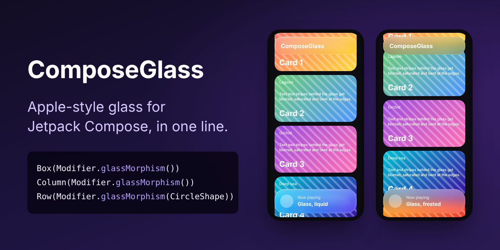
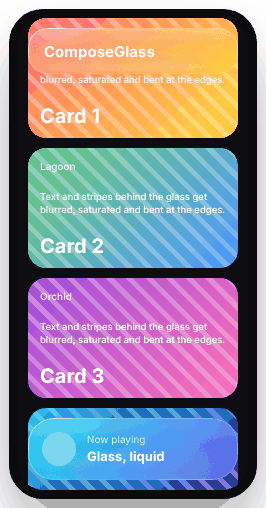

# ComposeGlass

[](https://jitpack.io/#al3j4ndrolm/ComposeGlass)
[](https://github.com/al3j4ndrolm/ComposeGlass/actions/workflows/build.yml)
[](LICENSE)

**Apple-style glass for Jetpack Compose in one line.** No wrapper, no state, no setup.

<p align="center">
  
</p>

From the maker of the Facilis family: [FacilisCam](https://github.com/al3j4ndrolm/FacilisCam), [FacilisStorage](https://github.com/al3j4ndrolm/FacilisStorage), [FacilisPermission](https://github.com/al3j4ndrolm/FacilisPermission), [FacilisNotification](https://github.com/al3j4ndrolm/FacilisNotification), [FacilisAI](https://github.com/al3j4ndrolm/FacilisAI) and [FacilisMaps](https://github.com/al3j4ndrolm/FacilisMaps).

```kotlin
Box(Modifier.glassMorphism()) {
    Text("Hello")
}
```

Whatever is drawn behind it, in the same window, is blurred, made more vibrant and bent at the edges like real glass.

<p align="center">
  
</p>

## Any composable

It's a modifier, so it goes on anything: `Box`, `Column`, `Row`, `Card`, `Button`, list items.

```kotlin
Column(
    Modifier
        .padding(16.dp)                                 // outside the glass
        .glassMorphism(shape = RoundedCornerShape(28.dp))
        .padding(20.dp),                                // inside the glass
) {
    Text("Now playing")
    Text("Glass, frosted")
}

Row(Modifier.glassMorphism(CircleShape).clickable { }.padding(12.dp)) {
    Icon(Icons.Default.Home, null)
    Text("Home")
}
```

Order works like `background()`: padding before the glass is space around it, padding after is space inside. Put `clickable` after it so the ripple stays inside the shape.

## Styles

```kotlin
Modifier.glassMorphism()                                  // Liquid Glass, the default
Modifier.glassMorphism(style = GlassDefaults.Light)       // frosted, like iOS menus and sheets
Modifier.glassMorphism(style = GlassDefaults.Dark)        // frosted, for dark mode
```

Tune any of them with `copy`:

```kotlin
Modifier.glassMorphism(
    shape = RoundedCornerShape(32.dp),
    style = GlassDefaults.Liquid.copy(refraction = 24.dp, sheen = 0.3f),
)
```

| `GlassStyle` | What it does | Liquid (default) |
|---|---|---|
| `blurRadius` | How frosted the backdrop is | `10.dp` |
| `saturation` | Vibrancy: colors glow through instead of going gray. 1 = unchanged | `1.6f` |
| `refraction` | How far the backdrop bends at the edges, like a lens. `0.dp` turns it off | `17.dp` |
| `tint` | Fill over the backdrop | white, 10% |
| `sheen` | Light reflection, brightest at the top | `0.24f` |
| `borderWidth` / `highlight` | Rim light, bright top-left with a softer glint bottom-right | `1.2.dp`, white 85% |
| `noise` | Fine grain, so it reads as a material | `0.02f` |
| `fallbackTint` | Used instead of blur before Android 12 | white, 72% |

## Android versions

| Android | You get |
|---|---|
| 13+ (API 33) | Everything: blur, vibrancy, refraction, sheen, rim light, grain |
| 12 (API 31) | Everything but refraction |
| 8 to 11 (API 26) | A translucent fill with sheen, rim light and grain; Android has no blur here |

Nothing to check yourself: the modifier picks the best it can do on each phone.

## Install

Add JitPack to `settings.gradle.kts`:

```kotlin
dependencyResolutionManagement {
    repositories {
        google()
        mavenCentral()
        maven("https://jitpack.io")
    }
}
```

Then add the dependency (min SDK 26):

```kotlin
implementation("com.github.al3j4ndrolm.ComposeGlass:glass:1.0.0")
```

## Good to know

- **How it works:** Compose can't read the pixels behind a composable, so just before each frame the window is drawn into a ¼-size bitmap with every glass surface hidden. One capture is shared by all the glass in a window. Each surface then blurs and bends its slice on the GPU (`RenderEffect`, plus an AGSL shader for refraction). It's the same idea BlurView uses for classic Views.
- **Video, camera and some maps** draw on their own surface (`SurfaceView`, `TextureView`), which the capture can't see, so they show up as empty behind the glass.
- **Glass on glass:** a surface inside another doesn't see the outer one; it blurs what's behind both.
- **Performance:** the capture redraws the window in software once per frame, only while something on screen changes. A handful of glass surfaces is cheap; dozens at once (every row of a long list) costs more. A lower `blurRadius` helps.
- **Refraction shapes:** rectangles and rounded corners (`RoundedCornerShape`, `CircleShape`, `RectangleShape`). Other shapes still get everything else.

## Contributing

```bash
./gradlew :glass:testDebugUnitTest :glass:assembleRelease :sample:assembleDebug
```

`glass/` is the library and `sample/` a demo app: a scrolling list under a glass top bar and player card.

## License

[MIT](LICENSE).
